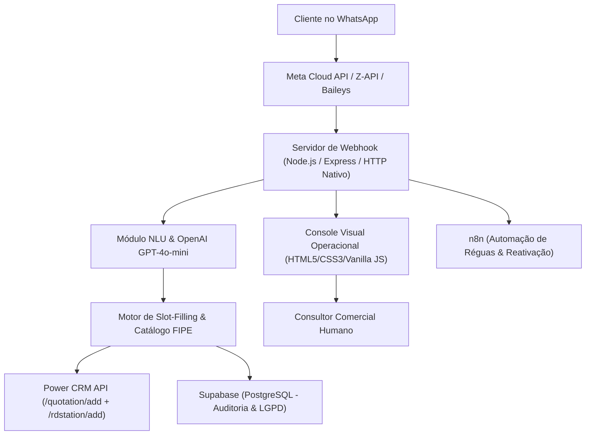
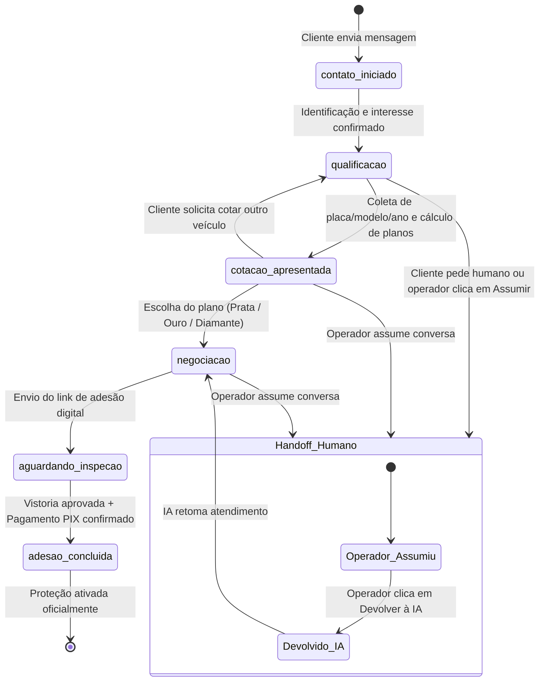

# Documento Técnico de Arquitetura e Engenharia: Agente Comercial IA BGR Benefícios & Guia de Replicabilidade por Nicho

Este documento consolida a especificação técnica completa, o histórico de engenharia, os serviços e integrações utilizados no desenvolvimento do **Agente Comercial de Inteligência Artificial da BGR Benefícios**, além de um **manual prático passo a passo** para estender ou replicar esta solução em qualquer outro nicho de mercado (como imobiliárias, clínicas, energia solar, consórcios e serviços B2B).

---

## 1. Visão Geral do Sistema e Objetivos de Negócio

O **Agente Comercial IA da BGR Benefícios** foi concebido para resolver o gargalo clássico de conversão comercial em canais de alto volume (WhatsApp): o tempo de resposta, a padronização de argumentos e a confiabilidade de dados de cotação.

### Problemas Resolvidos na Origem:
1. **Alucinação de Preços e Regras Comerciais:** Bloqueio estrito de valores inventados pelo LLM; preços são injetados exclusivamente a partir de regras parametrizadas ou da API oficial de CRM.
2. **Atendimento Contínuo 24/7 sem Fricção:** Coleta autônoma e contextual de dados do lead e do veículo (marca, modelo, ano, placa e coberturas) com tolerância a respostas parciais e abreviações.
3. **Inserção Direta no Funil de Vendas:** Cada cotação concluída gera automaticamente o cadastro do lead e o card de oportunidade na coluna *"Cotações recebidas"* do **Power CRM** sob a origem oficial `19266 (BGR - DIEGO)`.
4. **Handoff Humano Seguro:** Transição suave entre IA e operadores humanos, garantindo que a IA seja silenciada instantaneamente quando um consultor assume a conversa.
5. **Console Visual Operacional Unificado:** Painel com suporte a Modo Claro e Modo Escuro, permitindo que operadores acompanhem as conversas em tempo real, disparem ações em 1 clique (planos, placa, PIX, adesão digital) e assumam o controle com auditoria completa.

---

## 2. Pilha Tecnológica, Softwares e Serviços Utilizados



### 2.1. Backend e Servidor de Aplicação
- **Runtime:** `Node.js` (versão 22.6.0 ou superior com suporte a ES Modules nativos).
- **Linguagem:** `TypeScript` compilado em tempo de execução sem dependências pesadas de bundlers, garantindo baixa latência e inicialização em milissegundos.
- **Protocolo de Rede:** Servidor HTTP nativo Node.js (`node:http`) com suporte a CORS granular, permitindo operar em microserviços isolados ou servidor monolítico leve.
- **Ambiente de Nuvem:** `Render Cloud` (Web Service conectado diretamente ao repositório GitHub com continuous deployment automatizado em cada commit na branch `main`).

### 2.2. Inteligência Artificial e Processamento de Linguagem Natural (NLU)
- **Provedor:** `OpenAI API`.
- **Modelos:** `gpt-4o-mini` (padrão de alta velocidade e baixo custo para conversação comercial) com fallback para `gpt-4o` em análises contratuais complexas.
- **Técnica de NLU:** Abordagem híbrida (*Hybrid Rule-Based + LLM Slot-Filling*). Expressões regulares de alta precisão capturam placas (Mercosul e padrão antigo), números de telefone e anos, enquanto o LLM interpreta intenções contextuais, contornos de objeção e dúvidas frequentes.
- **Segurança de Prompt (Anti-Injection):** Sanitização rigorosa das mensagens do usuário antes do envio ao modelo, impedindo comandos de sistema (*jailbreaks*), exigência de descontos não autorizados ou vazamento de chaves de API.

### 2.3. Mensageria e Conectores de WhatsApp
- **Meta Cloud API (Oficial):** Suporte a envio de mensagens de texto dentro da janela de 24 horas e templates aprovados (HSM) para reengajamento após 24 horas.
- **Conectores Alternativos (Z-API / Baileys):** Abstração na camada `whatsapp-handoff` que permite operar com instâncias de API rápida para ambientes de homologação e testes interativos.
- **Deduplicação de Mensagens:** Hash e cache de `wamid` (WhatsApp Message ID) em memória para prevenir disparos duplicados provocados por retentativas de rede da Meta.

### 2.4. CRM & Gestão Comercial
- **Power CRM (API REST Oficial):**
  - Endpoint de Cotações: `POST https://api.powercrm.com.br/api/quotation/add`
  - Endpoint RD Station Integration: `POST https://api.powercrm.com.br/rdstation/add/19266`
  - Atributos Obrigatórios Injetados: `origemId: 19266`, `name`, `phone`, `phoneMobile1`, `email`, `noteContract` e identificadores do veículo.
  - Formatação Especial no Card: O nome do card no funil de vendas é formatado como `"${lead.name} • WhatsApp: ${formattedPhone}"`, permitindo visualização imediata do telefone do cliente sem necessidade de abrir abas internas.

### 2.5. Banco de Dados e Observabilidade
- **Supabase (PostgreSQL):**
  - Tabelas de auditoria comercial: `audit_trail`, `leads`, `quotations`, `conversation_history`.
  - Conformidade LGPD: Funções de mascaramento automático de CPF, telefone e placas em logs de auditoria antes da persistência.
  - Gestão de Atendentes: Tabela `attendants` com controle de status (`online`, `pausa`, `ocupado`, `offline`) e filas de roteamento (`comercial`, `retencao`, `sinistros`, `ouvidoria`).

### 2.6. Automação e Orquestração com n8n
- **Workflows Operacionais:**
  - *Workflow Principal:* Ingestão de webhooks, roteamento setorial (sinistro 24h, cancelamento, cotação nova).
  - *Régua de Vendas & Cobrança:* Cadência parametrizável (D+1, D+3, D+7) com checagem de horário comercial BRT (09:00 às 18:00 em dias úteis).
  - *Campanha de Reativação com Opt-Out:* Consulta à lista de supressão antes de qualquer envio. Caso o associado envie "PARAR", o opt-out é registrado imediatamente e bloqueia novos contatos.

---

## 3. Arquitetura da Máquina de Estados Comerciais

O ciclo de vida de cada conversa é governado por uma máquina de estados finita e determinística (`StateMachine`), impedindo que o cliente avance para etapas comerciais sem cumprir os requisitos obrigatórios:



### Regras Críticas de Transição:
1. **Loop Anti-Alucinação de Veículo:** Após a apresentação dos planos, a pergunta final é padronizada: *"Qual das opções faz mais sentido para você hoje, ou gostaria de cotar outro veículo?"*. Caso o cliente responda *"quero cotar outro"*, o sistema reseta as variáveis do veículo e retorna ao estado `qualificacao`, solicitando os dados do novo automóvel sem travar em repetições.
2. **Trava de Ativação Prematura (T27/T28/T29):** O estado `adesao_concluida` **nunca** é alcançado apenas pela alegação verbal do cliente ou pelo envio de comprovante no chat. É obrigatória a confirmação quadrupla: `proposal.signed` + `payment.confirmed` + `inspection.approved` + `member.activated`.

---

## 4. O Console Visual Operacional IA (Cockpit do Consultor)

O Console Visual foi construído em arquitetura ultra-leve (HTML5 sem frameworks pesados como React ou Angular) para garantir carregamento instantâneo, responsividade em qualquer dispositivo e atualização em tempo real via polling inteligente:

```
+---------------------------------------------------------------------------------------------------+
| [LOGO BGR] BGR Benefícios - Console Visual IA | Central de Atendimento | [☀️ Tema] [● WhatsApp] [BG] |
+--------+----------------------------+-----------------------------------+-------------------------+
| [NAV]  | [CONVERSAS]                | [CHAT DO CLIENTE AO VIVO]         | [FICHA DO LEAD]         |
| 💬 Atend| Busca: [ 🔍 Pesquisar... ]  | Cliente: Renato Ribeiro           | ABAS: Dados|Cotação|FAQ |
| 📊 Cock| Filtros: [Todas][IA][Humano]| (+55 21 96735-4521) [● IA Ativa]  | Nome: Renato Ribeiro    |
| 🧪 Simu|                            | Botões: [Assumir] [Mais Ações...] | Tel: (21) 96735-4521    |
| 📅 Régu| • Renato Ribeiro (Agora)   | --------------------------------- | Progresso: [====    ]   |
| 👥 Equi|   Qual das opções faz...   | Lead: Gostaria de saber o valor   | Veículo: GM SPIN LS 1.8 |
| 📱 Núme| • Danilo Jesus (14:07)     | Bot:  O Plano Prata fica R$119... | Placa: RFW7108          |
| 🔑 APIs| • Guilherme (14:02)        | --------------------------------- | FIPE: R$ 68.450,00      |
| 📈 KPIs|                            | Ações Rápidas: [Planos][Placa]... | Planos Oficiais:        |
| ❓ Ajud| Atualização em tempo real* | Digite sua resposta...   [Enviar] | [Prata][Ouro][Diamante] |
+--------+----------------------------+-----------------------------------+-------------------------+
```

### Funcionalidades Exclusivas da Interface:
- **Tema Claro (Base Branca) e Tema Escuro (Azul Noturno):** Alternância com persistência em `localStorage`.
- **Ações Rápidas em 1 Clique:** Disparo padronizado de mensagens comerciais com dados oficiais (`Enviar planos`, `Solicitar placa`, `Dados PIX` e `Adesão digital`).
- **Ficha Comercial Integrada:** 
  - Aba **Dados:** Visualização do contato, localidade e barra de progresso da qualificação.
  - Aba **Cotação:** Planos oficiais retornados da consulta com botão *"Preparar mensagem"*.
  - Aba **Dúvidas:** Respostas prontas para as 6 dúvidas mais comuns de proteção veicular (Associação x Seguradora, Guincho 24h, Carro Reserva, Cota de Participação/Franquia, Sem Consulta SPC, Motoristas de App).
- **Responsividade Adaptativa:** Quatro colunas no desktop, ficha em gaveta lateral (drawer) no tablet e alternância fluida entre lista e conversa no mobile.

---

## 5. Suíte de Testes e Validação Automatizada (40/40 Testes Aprovados)

O projeto conta com uma cobertura rigorosa de testes executados com o test-runner nativo do Node.js (`node --test`), estruturados em 7 fases:

| Suíte de Teste | Quantidade | Escopo e Cenários Validados |
| :--- | :---: | :--- |
| `contracts.test.ts` | 5 testes | Validação de contratos tipados, bloqueio de dados incompletos, máquina de estados e sanitização LGPD. |
| `quotation-service.test.ts` | 5 testes | Cotação oficial, contorno de objeções comerciais e bloqueio de desconto não autorizado. |
| `proposal-lifecycle.test.ts` | 4 testes | Ciclo de vida da proposta, impedindo ativação prematura sem vistoria e pagamento. |
| `whatsapp-handoff.test.ts` | 6 testes | Handoff humano, isolamento de sessões por telefone, deduplicação de wamid e templates de 24h. |
| `campaign-followup.test.ts` | 6 testes | Réguas de vendas e cobrança, horário comercial BRT, cadência D+1/D+3/D+7 e opt-out (PARAR). |
| `powercrm-adapter.test.ts` | 9 testes | Resiliência HTTP, injeção na origem 19266, tratamento de erros 401/403/404/429/503 e mascaramento. |
| `homologacao-32-cenarios.test.ts` | 5 testes | Cenários E2E (T01 a T32) cobrindo saudação única, slot-filling e cálculo de KPIs gerenciais. |

---

## 6. Guia Passo a Passo: Como Replicar Esta Ferramenta para Outro Nicho

Para adaptar este agente para um novo segmento (ex: **Imobiliária**, **Clínica Odontológica/Médica**, **Energia Solar Fotovoltaica**, **Contabilidade Consultiva** ou **Consórcios**), siga este roteiro de 6 etapas:

### Passo 1: Mapeamento de Entidades e Variáveis do Nicho
Substitua os dados de proteção veicular (placa, modelo, ano, FIPE) pelas entidades críticas do novo nicho:
- *Imobiliário:* Tipo de imóvel (casa/apto), bairros de interesse, número de quartos, faixa de orçamento, finalidade (alugar ou comprar).
- *Clínica Odontológica:* Procedimento desejado (implante, ortodontia, clareamento), queixa principal, plano/particular, disponibilidade de horário.
- *Energia Solar:* Valor médio da conta de luz em R$, tipo de telhado, cidade/concessionária de energia, tipo de ligação (mono/bi/trifásica).
- *Contabilidade:* Regime tributário (Simples/Presumido), número de funcionários, faturamento médio mensal, segmento de atuação.

### Passo 2: Configuração dos Conectores de CRM
Adapte a camada `src/adapters/` para se comunicar com o CRM líder do nicho:
- *Imobiliário:* Conectar com **Vista Soft**, **Kenlo** ou **RD Station CRM**.
- *Saúde / Clínicas:* Conectar com **Feegow**, **Clinicorp** ou **Simples Dental**.
- *Vendas Gerais / B2B:* Conectar com **HubSpot**, **Pipedrive** ou **Kommo**.
- No arquivo de adapter, configure:
  - URL Base e Token Bearer nas variáveis de ambiente.
  - Mapeamento do payload JSON para criar o Lead e a Oportunidade no funil correto.

### Passo 3: Engenharia de Prompts e Slot-Filling Específico
1. Edite o arquivo de regras contextuais (`knowledge-base/` ou `prompts/`):
   - Defina a persona do bot (ex: *"Você é a Sofia, consultora digital da Clínica Sorriso Perfeito"*).
   - Estabeleça a política de preços: nunca prometa preços finais de tratamentos ou imóveis sem consulta; ofereça faixas estimadas ou agendamento de avaliação.
2. Atualize o validador de slots em `src/services/slot-filling.ts` para reconhecer os campos do novo nicho.

### Passo 4: Configuração da Máquina de Estados e Réguas de Follow-Up
1. Altere os estados canônicos no enum do `contracts.schema.json`:
   - Exemplo Imobiliário: `contato_iniciado` -> `perfil_coletado` -> `imoveis_apresentados` -> `visita_agendada` -> `proposta_enviada`.
2. Configure a régua de mensagens no n8n:
   - D+1: Feedback sobre as opções enviadas.
   - D+3: Oferta de nova opção similar ou convite para visita.
   - D+7: Reativação ou arquivamento respeitando opt-out.

### Passo 5: Personalização do Console Visual
1. Substitua o arquivo `public/logo.png` pela logo do novo cliente/nicho.
2. No arquivo `src/api/visual-server.ts`:
   - Atualize as variáveis de cor principal (ex: verde para saúde, laranja para energia solar, azul escuro para imobiliárias).
   - Adapte as 4 pílulas de ações rápidas no chat (ex: `Agendar Visita`, `Enviar Catálogo`, `Simular Financiamento`, `Chave PIX`).
   - Adapte a Ficha do Lead: substitua os campos do veículo pelos campos do novo nicho (ex: *Imóvel Pretendido*, *Bairro*, *Faixa de Preço*).
   - Atualize a aba de Dúvidas (FAQ) com as objeções mais comuns do setor.

### Passo 6: Implantação e Monitoramento
1. Crie o repositório no GitHub para o novo cliente.
2. Configure o Web Service no Render ou em qualquer VPS (DigitalOcean, AWS, Hetzner).
3. Conecte o Webhook do WhatsApp oficial e valide as variáveis de ambiente:
   - `OPENAI_API_KEY`
   - `CRM_API_TOKEN` / `CRM_ORIGIN_ID`
   - `SUPABASE_URL` / `SUPABASE_KEY`
   - `AGENT_PHONE`
4. Execute a suíte de testes unitários (`npm test`) para garantir que 100% dos fluxos de qualificação estão operando sem falhas.

---

## 7. Conclusão

A arquitetura desenvolvida para a **BGR Benefícios** estabelece um padrão de excelência em agentes comerciais autônomos: alia a fluidez da inteligência artificial generativa com a confiabilidade rígida de regras comerciais e integração com sistemas de gestão. Graças ao desacoplamento modular de suas camadas (Interface, NLU, Mensageria, CRM e Máquina de Estados), a solução está pronta para escala contínua e replicação imediata para novos mercados.
