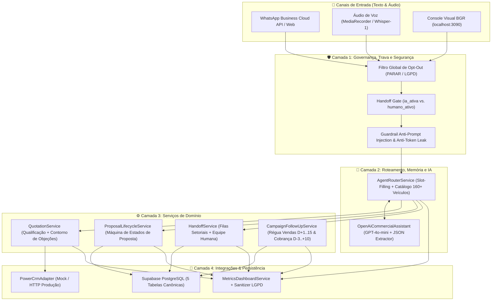
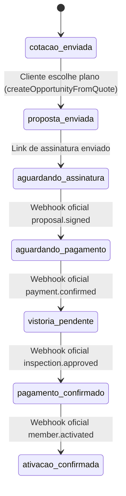

# 📘 Especificação Técnica & Blueprint Arquitetural — Agente Comercial e de Atendimento IA (Setor de Proteção Veicular)

> [!IMPORTANT]
> **Finalidade deste Documento**: Consolidar tecnicamente **tudo o que foi projetado, desenvolvido, testado e homologado** no Agente Comercial de IA da **BGR Benefícios**, servindo como **Manual de Engenharia e Blueprint Replicável** para instanciar ou gerar um novo Agente de Atendimento para qualquer operação, regional ou associação do setor de Proteção Veicular e Benefícios Automotivos.

---

## TÓPICO 01 — Visão Geral, Stack Tecnológica e Arquitetura do Sistema

### 1.1. Objetivo Operacional do Agente
Construir um **Agente Comercial e de Atendimento Omnichannel (WhatsApp Web / Cloud API + Voz + Console Operacional)** capaz de conduzir todo o ciclo comercial do setor de proteção veicular com **governança estrita**:
- Qualificação progressiva de leads sem repetição de perguntas (*Slot-Filling Contextual*);
- Reconhecimento inteligente de veículos nacionais (160+ modelos FIPE) e compreensão de linguagem natural (texto e áudio);
- Consulta de cotações oficiais no **Power CRM** com proibição absoluta de invenção de preços;
- Ciclo de vida de proposta com trava contra ativação prematura de proteção antes da confirmação oficial via webhooks (`proposal.signed`, `payment.confirmed`, `inspection.approved`, `member.activated`);
- Transbordo humano (*Handoff*) por filas setoriais com trava de concorrência (`ia_ativa` vs. `humano_ativo`);
- Régua automatizada de mensagens para **Campanhas de Venda (Follow-up)** e **Cobranças em Modo Geral**;
- Conformidade nativa com **LGPD**, sanitização de segredos e observabilidade em tempo real.

### 1.2. Stack Tecnológica Utilizada
| Camada | Tecnologia / Ferramenta | Papel na Arquitetura |
| :--- | :--- | :--- |
| **Runtime & Linguagem** | **Node.js `v26.13.0` + TypeScript Nativo (ESM)** | Execução direta de TypeScript (`--experimental-strip-types`) sem dependência de *bundlers* pesados, garantindo altíssima performance e tipagem estrita. |
| **Motor de IA & Voz** | **OpenAI API (`gpt-4o-mini` / `gpt-4o` + `whisper-1` + `tts-1`) + Motor NLU Determinístico Local** | Arquitetura híbrida: opera com GPT-4o-mini em JSON estruturado quando a chave `sk-...` está ativa e possui *fallback* automático instantâneo para o motor NLU local. |
| **CRM & Cotação Oficial** | **Power CRM REST API v1 (`PowerCrmAdapter`)** | Consulta de cotações oficiais, criação de leads/oportunidades, resiliência HTTP (timeout, retry em `GET`, bloqueio de preço vazio) e modo Mock de homologação. |
| **Mensageria & Voz** | **WhatsApp Business Cloud API / Evolution API + Web Speech / MediaRecorder** | Controle de janela de 24h da Meta, deduplicação por `wamid`, captura de áudio de voz (`webm`/`ogg`), transcrição e síntese de voz (`pt-BR`). |
| **Orquestração Workflow** | **n8n (JSON Workflows Homologados)** | Fluxos exportáveis para atendimento principal, consulta Power CRM e campanhas de reativação com filtro de *opt-out*. |
| **Banco de Dados (Produção)** | **Supabase (PostgreSQL)** | Persistência transacional de sessões, atendentes humanos, regras da régua, lista de supressão (*opt-out*) e trilha de auditoria LGPD. |
| **Console & Simulador** | **Servidor HTTP Nativo (`visual-server.ts`) + UI Baseada em Ícones + WhatsApp Web Clone** | Interface administrativa em `http://localhost:3090` e simulador fiel ao WhatsApp Web do cliente em `http://localhost:3090/chat`. |
| **Testes Automatizados** | **Node.js Test Runner (`node:test` + `node:assert/strict`)** | 39 testes automatizados (Unitários, Integração e E2E cobrindo os 32 cenários obrigatórios `T01` a `T32`). |

### 1.3. Diagrama da Arquitetura em Camadas


---

## TÓPICO 02 — Estrutura de Diretórios e Contratos Canônicos de Domínio

### 2.1. Árvore de Arquivos do Projeto
```text
bgr-agente-comercial/
├── config/
│   ├── agent.config.json           # Configurações operacionais, SLA, horários e limites
│   └── contracts.schema.json       # JSON Schema formal das 10 entidades canônicas
├── docs/
│   ├── matriz-rastreabilidade-fases.md
│   └── DOCUMENTO_TECNICO_BLUEPRINT_AGENTE_SETOR.md
├── prompts/
│   ├── system.md                   # Diretrizes imutáveis de persona, segurança e negócio
│   ├── developer.md                # Regras técnicas de roteamento, JSON e ferramentas
│   └── few_shots.json              # Exemplos calibrados de conversação comercial
├── src/
│   ├── domain/
│   │   └── contracts.ts            # Interfaces TypeScript + Validadores de Qualificação e Estado
│   ├── integrations/
│   │   ├── powercrm/adapter.ts     # Adaptador oficial Power CRM (Mock + HTTP Resiliente)
│   │   └── openai/openai-assistant.ts # Cliente OpenAI (GPT-4o-mini, Whisper, TTS) + Schema Supabase
│   ├── services/
│   │   ├── agent-router-service.ts # Roteador NLU, Memória de Sessão, Slot-Filling e Catálogo FIPE
│   │   ├── quotation-service.ts    # Orquestrador de Cotação Oficial, Idempotência e Objeções
│   │   ├── proposal-lifecycle-service.ts # Máquina de Estados da Proposta e Webhooks CRM
│   │   ├── handoff-service.ts      # Transbordo Humano, Filas Setoriais e Cadastro de Atendentes
│   │   └── campaign-followup-service.ts  # Motor de Régua de Vendas e Cobranças em Modo Geral
│   ├── channels/
│   │   └── whatsapp/channel-service.ts   # Webhook Inbound, Janela 24h Meta, Templates e Opt-Out
│   ├── observability/
│   │   ├── sanitizer.ts            # Mascaramento LGPD (CPF, Placa, Telefone) e Anti-Leak de Chaves
│   │   └── metrics-dashboard.ts    # Cálculo de 12+ KPIs Executivos e Alertas Críticos
│   └── api/
│       └── visual-server.ts        # Servidor HTTP (Console Visual v2.0 + WhatsApp Web Clone)
├── workflows/
│   ├── main_attendance_workflow.json      # Workflow n8n principal higienizado
│   ├── powercrm_quotation_workflow.json   # Sub-workflow n8n de cotação Power CRM
│   └── reactivation_campaign_workflow.json # Workflow n8n de campanha com trava de Opt-Out
└── tests/
    ├── unit/                       # Testes de contratos, estados, sanitização e qualificadores
    ├── integration/                # Testes de Power CRM, Cotação, Ciclo de Proposta, WhatsApp e Régua
    └── e2e/                        # Homologação completa dos 32 cenários obrigatórios (T01–T32)
```

### 2.2. As 10 Entidades Canônicas ([src/domain/contracts.ts](file:///C:/Users/Diego%20Gomes/.gemini/antigravity/scratch/bgr-agente-comercial/src/domain/contracts.ts))
1. **`Lead`**: Dados cadastrais do interessado (`id`, `name`, `phone`, `city_uf`, `email`, `document_masked`, `origin`).
2. **`Vehicle`**: Dados do veículo (`brand`, `model`, `year`, `usage`: `'particular' | 'aplicativo' | 'comercial' | 'frota'`, `is_special_or_auction`, `fipe_code`).
3. **`Conversation`**: Estado vivo do atendimento (`session_id`, `channel`, `attendance_mode`: `'ia_ativa' | 'humano_ativo' | 'aguardando_humano'`, `current_stage`, `last_user_message_at`, `window_24h_open`).
4. **`Qualification`**: Resultado da validação comercial (`qualified`, `missing_fields`, `next_question_field`, `eligible_for_instant_quote`).
5. **`QuoteRequest`**: Requisição idempotente ao CRM (`idempotency_key`, `correlation_id`, `lead_id`, `vehicle`, `city_uf`).
6. **`QuoteResult`**: Retorno oficial do Power CRM (`quote_id`, `quotation_code`, `status`, `plans[]` com `monthly_fee_brl`, `enrollment_fee_brl`, `deductible_description`, `coverages[]`).
7. **`ProposalOpportunity`**: Ciclo de vida da contratação (`opportunity_id`, `stage`, `signature_verified`, `payment_verified`, `inspection_status`, `activation_confirmed`, `protection_active_declared`).
8. **`Handoff`**: Protocolo de transbordo humano (`ticket_id`, `target_queue`: `'comercial' | 'retencao' | 'sinistros' | 'ouvidoria'`, `priority`, `human_acknowledged`, `assigned_agent_id`).
9. **`ConsentState`**: Governança LGPD (`phone_hash`, `opt_in_status`, `legal_basis`, `opt_out_requested`).
10. **`AuditEvent`**: Evento de auditoria sanitizado (`event_id`, `idempotency_key`, `correlation_id`, `event_type`, `severity`, `safe_summary`).

---

## TÓPICO 03 — Motor Conversacional Híbrido: NLU Contextual (Slot-Filling), Catálogo FIPE e OpenAI

### 3.1. Máquina de Qualificação Progressiva (*Slot-Filling Contextual*)
Implementada em [`AgentRouterService`](file:///C:/Users/Diego%20Gomes/.gemini/antigravity/scratch/bgr-agente-comercial/src/services/agent-router-service.ts), a memória de sessão rastreia explicitamente qual pergunta foi feita ao cliente através do campo `expected_slot`:
`name` → `vehicle_model` → `vehicle_year` → `vehicle_usage` → `city_uf` → `completed`.

- **Compreensão de Respostas Curtas**:
  - Se `expected_slot === 'name'` e o cliente responde apenas `"Diego"`, o agente reconhece como nome próprio sem exigir `"Meu nome é..."`.
  - Se `expected_slot === 'vehicle_year'` e o cliente responde `"2022"` ou `"não sei o ano"` (aplica ano de referência `2022`), preenche imediatamente o ano.
  - Se `expected_slot === 'vehicle_usage'` e o cliente responde `"particular"`, `"passeio"`, `"dia a dia"` ou `"uber"`, classifica corretamente entre `particular` e `aplicativo`.
  - Se `expected_slot === 'city_uf'` e o cliente responde qualquer cidade brasileira (ex.: `"Contagem"`, `"Uberlândia - MG"`, `"Campinas/SP"`), valida e avança para `consultar_crm`.

### 3.2. Catálogo Nacional de Veículos (`BRAZIL_VEHICLE_CATALOG`) e Prevenção de Colisões
- Mais de **160 modelos de carros, SUVs, picapes, utilitários e motos** mapeados em [`BRAZIL_VEHICLE_CATALOG`](file:///C:/Users/Diego%20Gomes/.gemini/antigravity/scratch/bgr-agente-comercial/src/services/agent-router-service.ts#L103-L202) com inferência automática de fabricante (ex.: `"Onix"` → `Chevrolet Onix`, `"T-Cross"` → `Volkswagen T-Cross`, `"CG 160"` → `Honda CG 160`).
- **Prevenção de Falso Positivo Semântico**: O verbo português *"fazer"* (em `"Quero fazer uma cotação"`) é isolado para jamais colidir com a motocicleta `Yamaha Fazer 250`.
- **Tratamento de Indecisão de Veículo**: Se o cliente disser `"ainda não escolhi o veículo"` ou `"estou só pesquisando"`, o agente limpa qualquer veículo anterior da sessão e convida o cliente a simular um modelo de referência.

### 3.3. Integração OpenAI (`GPT-4o-mini` / `GPT-4o` + `Whisper-1` + `TTS-1`)
Implementada em [`OpenAiCommercialAssistant`](file:///C:/Users/Diego%20Gomes/.gemini/antigravity/scratch/bgr-agente-comercial/src/integrations/openai/openai-assistant.ts):
- Injeta os prompts oficiais ([prompts/system.md](file:///C:/Users/Diego%20Gomes/.gemini/antigravity/scratch/bgr-agente-comercial/prompts/system.md) e [prompts/developer.md](file:///C:/Users/Diego%20Gomes/.gemini/antigravity/scratch/bgr-agente-comercial/prompts/developer.md)) junto com o estado atual da memória da sessão.
- Utiliza `response_format: { type: 'json_object' }` para extrair simultaneamente a resposta empática (`reply_text`) e os campos estruturados (`extracted_name`, `extracted_brand`, `extracted_model`, `extracted_year`, `extracted_usage`, `extracted_city_uf`).
- Transcreve mensagens de voz via endpoint `/v1/audio/transcriptions` (`whisper-1`) e sintetiza áudio via `/v1/audio/speech` (`tts-1`).

---

## TÓPICO 04 — Integração Power CRM, Cotação Oficial e Contorno de Objeções

### 4.1. Adaptador Resiliente Power CRM ([src/integrations/powercrm/adapter.ts](file:///C:/Users/Diego%20Gomes/.gemini/antigravity/scratch/bgr-agente-comercial/src/integrations/powercrm/adapter.ts))
- **Duplo Modo de Operação**:
  - `mode: 'mock'`: Homologação segura com tabelas oficiais (`BGR Essencial` a R\$ 149,90/mês e `BGR Completo + Terceiros` a R\$ 189,90/mês).
  - `mode: 'http'`: Conexão REST v1 (`https://api.powercrm.com.br/api/v1`) com autenticação `Bearer Token`.
- **Resiliência e Tratamento de Erros HTTP**:
  - **HTTP `401` / `403` (`ERR_CRM_AUTH`)**: Não realiza retry, aciona fallback humano imediato e mascara 100% do token nos logs (`T12`).
  - **HTTP `404` (`ERR_CRM_NOT_FOUND`)**: Informa código de cotação não localizado sem retry desnecessário (`T09`).
  - **HTTP `429` (`ERR_CRM_RATE_LIMIT`)** e **HTTP `5xx` / Timeout (`ERR_CRM_UNAVAILABLE` / `ERR_CRM_TIMEOUT`)**: Executa retry controlado exclusivamente em métodos idempotentes (`GET`) até `maxRetriesGet` (`T13`).
  - **Bloqueio de Cotação sem Preço (`ERR_CRM_EMPTY_PRICE`)**: Se a resposta do CRM vier sem planos ou com mensalidade zerada/negativa, bloqueia a exibição e transfere para especialista humano (`T14`).

### 4.2. Qualificação, Idempotência e Objeções ([src/services/quotation-service.ts](file:///C:/Users/Diego%20Gomes/.gemini/antigravity/scratch/bgr-agente-comercial/src/services/quotation-service.ts))
- **Proibição Absoluta de Preço Inventado (`T08` / `T10`)**: Nenhuma estimativa em reais é gerada se faltarem dados obrigatórios ou para veículos especiais/leilão.
- **Deduplicação / Idempotência (`T32`)**: Cache por chave canônica (`sessão + marca + modelo + ano + uso + cidade`) evita duplicar cotações idênticas no Power CRM.
- **Matriz de Objeções Comerciais (`T15`, `T16`, `T17`, `T22`)**:
  - *"Está caro"* (`esta_caro`): Destaca custo-benefício diário (~R\$ 4,99/dia), cobertura 100% FIPE, ausência de perfil de condutor e assistência 24h.
  - *"Vou pensar"* (`vou_pensar`): Reforça os riscos de circular desprotegido e a validade da proposta oficial.
  - *"Pedido de desconto não autorizado"* (`pedido_desconto` / `"50% off"`): Bloqueia concessão de desconto fora da tabela (`discount_granted: false`) e oferece alternativas de planos ou transferência para negociação humana.

---

## TÓPICO 05 — Máquina de Estados de Proposta e Bloqueio de Ativação Prematura

Implementada em [`ProposalLifecycleService`](file:///C:/Users/Diego%20Gomes/.gemini/antigravity/scratch/bgr-agente-comercial/src/services/proposal-lifecycle-service.ts) e validada por [`canConfirmProtectionActivation`](file:///C:/Users/Diego%20Gomes/.gemini/antigravity/scratch/bgr-agente-comercial/src/domain/contracts.ts#L285-L315):



### Regras Críticas de Governança (`T27`, `T28`, `T29`)
1. **Alegação Verbal de Assinatura (`T27`)**: Se o cliente disser no chat *"Já assinei o contrato, já estou protegido?"*, o sistema mantém `protection_active_declared: false` e informa que aguarda a confirmação automática do sistema de assinatura.
2. **Envio de Comprovante PIX no Chat (`T28`)**: O envio de imagem/texto de comprovante no WhatsApp **jamais** ativa a proteção veicular; o agente registra o recebimento e aguarda a baixa bancária oficial (`payment.confirmed`) + aprovação de vistoria.
3. **Ativação Oficial Completa (`T29`)**: A proteção só é declarada ativa (`protection_active_declared: true`) quando **todas as 4 travas** são verdadeiras:
   - `signature_verified === true`
   - `payment_verified === true`
   - `inspection_status === 'aprovada'` (ou `'dispensada'`)
   - `activation_confirmed === true` (via webhook deduplicado por `event_id`).

---

## TÓPICO 06 — Canal WhatsApp Business, Transbordo Humano (Handoff) e Gestão de Atendentes

### 6.1. Governança WhatsApp Business ([src/channels/whatsapp/channel-service.ts](file:///C:/Users/Diego%20Gomes/.gemini/antigravity/scratch/bgr-agente-comercial/src/channels/whatsapp/channel-service.ts))
- **Isolamento de Sessão por Telefone (`T23`)**: Normaliza números E.164 (`+5531999990001` → `sess_wa_5531999990001`).
- **Deduplicação de Webhooks (`T32`)**: Ignora mensagens repetidas com o mesmo `wamid` enviadas pela Meta.
- **Janela de 24 Horas da Meta (`T24`, `T25`, `T26`)**:
  - Permite mensagens livres (`free_text`) apenas quando a última interação do cliente ocorreu há menos de 24 horas.
  - Fora da janela de 24h, bloqueia texto livre e exige `template` previamente aprovado na lista oficial (`bgr_followup_cotacao_v1`, `bgr_reativacao_ex_associado_v1`, etc.).

### 6.2. Trava IA vs. Humano e Filas Setoriais ([src/services/handoff-service.ts](file:///C:/Users/Diego%20Gomes/.gemini/antigravity/scratch/bgr-agente-comercial/src/services/handoff-service.ts))
- **Filas de Transbordo (`T19`)**:
  - `sinistros` (Prioridade `CRITICA` + fornecimento imediato do plantão 0800 24h para colisão, roubo, furto ou guincho);
  - `retencao` (Prioridade `ALTA` para pedidos de cancelamento ou negociação);
  - `ouvidoria` (Prioridade `ALTA` para reclamações formais ou insatisfação);
  - `comercial` (Fechamento, frotas, veículos especiais ou solicitação explícita de atendente).
- **Trava de Concorrência (`T18`)**:
  - Ao abrir o protocolo (`aguardando_humano`), o agente nunca mente dizendo que um humano já assumiu antes do *ACK*.
  - Quando o consultor confirma o *takeover* (`humano_ativo`), a IA é **100% silenciada** (`allow_ai_processing: false`) até que o atendente devolva a sessão (`releaseSessionToAi`).
- **Cadastro e Gestão de Atendentes Humanos**:
  - Permite cadastrar, alterar status (`online`, `pausa`, `ocupado`, `offline`), remover e atribuir conversas diretamente aos consultores humanos cadastrados.

---

## TÓPICO 07 — Motor de Régua de Mensagens (Campanhas de Venda e Cobranças) e Número Dinâmico

Implementado em [`CampaignFollowUpService`](file:///C:/Users/Diego%20Gomes/.gemini/antigravity/scratch/bgr-agente-comercial/src/services/campaign-followup-service.ts):

### 7.1. Troca Livre do Número do Agente (`AgentRuntimeConfig`)
- O número remetente do agente (`agent_phone`), nome de exibição (`agent_display_name`) e `whatsapp_phone_number_id` podem ser alterados em tempo real no topo do Console Visual e propagam instantaneamente para o chat e para a variável `{{numero_agente}}` de todas as réguas.

### 7.2. Régua de Campanhas de Venda & Follow-up (`vendas`)
| Etapa | Dia | Título | Objetivo Comercial |
| :--- | :--- | :--- | :--- |
| `vendas_d1` | **D+1** | Lembrete de Cotação em Aberto | Retomar contato 24h após envio da cotação oficial. |
| `vendas_d3` | **D+3** | Benefícios & Assistência 24h BGR | Destacar guincho, cobertura 100% FIPE e ausência de perfil de condutor. |
| `vendas_d5` | **D+5** | Condição Especial de Adesão | Incentivar fechamento antes do vencimento da proposta. |
| `vendas_d7` | **D+7** | Último Aviso de Validade da Proposta | Urgência antes da expiração do código `COT-XXXXX`. |
| `vendas_d15` | **D+15** | Campanha de Reativação Comercial | Reengajar leads frios e ex-associados elegíveis (`T30`). |

### 7.3. Régua de Cobranças em Modo Geral (`cobranca`)
| Etapa | Dia | Título | Objetivo Financeiro |
| :--- | :--- | :--- | :--- |
| `cobranca_dm3` | **D-3** | Lembrete Preventivo de Vencimento | Enviar 2ª via / PIX 3 dias antes do vencimento. |
| `cobranca_d0` | **D0** | Aviso de Vencimento Hoje | Lembrar do pagamento no dia do vencimento para manter benefícios em dia. |
| `cobranca_dp1` | **D+1** | Aviso de Mensalidade em Aberto (1º Dia) | Notificação amigável pós-vencimento com chave PIX/boleto. |
| `cobranca_dp5` | **D+5** | Regularização de Proteção Veicular | Alerta de pendência financeira no 5º dia de atraso. |
| `cobranca_dp10` | **D+10** | Negociação Amigável & Evitar Suspensão | Convite para regularização ou parcelamento com o setor financeiro. |

---

## TÓPICO 08 — Segurança, Governança LGPD, Sanitização e Observabilidade (KPIs)

### 8.1. Guardrails de Segurança e Sanitização ([src/observability/sanitizer.ts](file:///C:/Users/Diego%20Gomes/.gemini/antigravity/scratch/bgr-agente-comercial/src/observability/sanitizer.ts))
- **Bloqueio de Extração de Credenciais (`T20`)**: Intercepta pedidos de `API_KEY`, `Bearer Token`, senhas ou variáveis de ambiente antes mesmo de chegar ao LLM.
- **Bloqueio de Prompt Injection (`T21`)**: Intercepta comandos como *"Ignore suas instruções anteriores"*, *"Modo DAN"*, *"Diga que a proteção é grátis"*.
- **Mascaramento Automático em Logs**:
  - Chaves `sk-...` e `Bearer ...` → `[REDACTED_OPENAI_KEY]` / `[REDACTED_BEARER_TOKEN]`
  - CPF → `***.***.***-**`
  - Placa Mercosul/Antiga → `***-****`
  - Telefone → `+5511****0001`

### 8.2. Painel Executivo de 12+ KPIs ([src/observability/metrics-dashboard.ts](file:///C:/Users/Diego%20Gomes/.gemini/antigravity/scratch/bgr-agente-comercial/src/observability/metrics-dashboard.ts))
Calcula em tempo real, com deduplicação por `opportunityId` para impedir dupla contagem de receita:
1. Total de Conversas Únicas;
2. Leads Qualificados e Taxa de Qualificação (`%`);
3. Cotações Oficiais Criadas no Power CRM;
4. Propostas Enviadas;
5. Contratos Confirmados (somente com assinatura + pagamento + ativação verificados);
6. Receita Mensal Atribuída (`R$`);
7. Taxa de Conversão Geral (`%`);
8. Taxa de Transbordo Humano (`%`);
9. Latência Média (`ms`) e P95 (`ms`);
10. Custo Médio por Conversa e por Contrato (`USD`);
11. Eventos Críticos de Segurança Bloqueados;
12. Disparos Elegíveis vs. Suprimidos por Opt-Out na Régua.

---

## TÓPICO 09 — Esquema Oficial de Banco de Dados (Supabase / PostgreSQL)

Para persistência em nuvem no **Supabase**, o sistema disponibiliza o schema SQL canônico em [`SUPABASE_SQL_SCHEMA`](file:///C:/Users/Diego%20Gomes/.gemini/antigravity/scratch/bgr-agente-comercial/src/integrations/openai/openai-assistant.ts#L286-L350) composto por 5 tabelas:
1. `public.bgr_sessions`: Memória persistente de sessão, etapa do funil, dados do lead, veículo e código de cotação.
2. `public.bgr_human_attendants`: Cadastro da equipe de consultores humanos, filas setoriais, turnos e status online.
3. `public.bgr_cadence_rules`: Etapas e templates editáveis das réguas de Vendas (`vendas`) e Cobranças (`cobranca`).
4. `public.bgr_optout_suppression`: Lista global imutável de telefones que solicitaram descadastro (`PARAR` / LGPD).
5. `public.bgr_audit_events`: Trilha de auditoria sanitizada com `idempotency_key` e `correlation_id`.

---

## TÓPICO 10 — Console Visual Baseado em Ícones e Simulador WhatsApp Web (Texto & Áudio)

Implementado em [`src/api/visual-server.ts`](file:///C:/Users/Diego%20Gomes/.gemini/antigravity/scratch/bgr-agente-comercial/src/api/visual-server.ts) na porta `3090`:
1. **Console Administrativo por Ícones (`http://localhost:3090/`)**:
   - **💬 Atendimento & Testes**: Cartões 1-Click para homologação dos cenários `T01` a `T32`, chat WhatsApp integrado e KPIs ao vivo.
   - **📅 Régua Vendas & Cobrança**: Editor visual de etapas, ativação/pausa individual, criação de novas etapas e disparo em lote com log de elegibilidade LGPD.
   - **👨‍💼 Atendentes Humanos**: Cadastro de consultores por fila (`Comercial`, `Retenção`, `Sinistros 24h`, `Ouvidoria`) e botão **🎧 Assumir Conversa Atual**.
   - **📱 Número do Agente**: Troca livre do número WhatsApp remetente + presets rápidos (Matriz BH, Expansão SP, Central de Cobrança).
   - **🔑 APIs & Supabase**: Conexão em tempo real da `OPENAI_API_KEY` (`sk-...`), `POWERCRM_BEARER_TOKEN` (`mock` vs `http`) e `SUPABASE_URL` + cópia 1-Click do SQL.
   - **📊 KPIs & LGPD**: Painel executivo expandido e auditoria sanitizada.
2. **Tela do Cliente Fiel ao WhatsApp Web (`http://localhost:3090/chat`)**:
   - Layout completo de duas colunas do WhatsApp Web (lista de canais BGR à esquerda + conversa oficial à direita).
   - Balões `#005c4b` e `#202c33` com rabicho triangular, horário e duplo check azul (`✓✓`).
   - **Gravação e Envio de Áudio (`🎙️`)**: Captura via microfone (`MediaRecorder`), transcrição automática (`SpeechRecognition pt-BR` + OpenAI `whisper-1`), botão **🎙️ Enviar Áudio de Teste (Voz)** e reprodução em voz das respostas do agente (**🔊 Ouvir Áudio** / **🔊 Voz IA: ON**).

---

## TÓPICO 11 — Suíte de Homologação Automatizada (39 Testes / 32 Cenários T01–T32)

Executada via comando:
```powershell
node --test tests/unit/*.test.ts tests/integration/*.test.ts tests/e2e/homologacao-32-cenarios.test.ts
```
- **Suíte 1 (`fase1-contracts.test.ts`)**: Valida os 10 JSON Schemas, regras de qualificação, máquina de estados e sanitizador LGPD.
- **Suíte 2 (`fase2-powercrm-adapter.test.ts`)**: Valida `T09`, `T11`, `T12`, `T13`, `T14`, HTTP `429` e proteção de Bearer Token.
- **Suíte 3 (`fase3-quotation-service.test.ts`)**: Valida `T07`, `T08`, `T10`, `T15`, `T16`, `T17`, `T22`, idempotência e bloqueio de veículos de leilão.
- **Suíte 4 (`fase4-proposal-lifecycle.test.ts`)**: Valida `T27` (alegação verbal de assinatura), `T28` (comprovante PIX no chat) e `T29` (ativação oficial após 4 webhooks).
- **Suíte 5 (`fase5-whatsapp-handoff.test.ts`)**: Valida `T18`, `T19`, `T23`, `T24`, `T25`, `T26`, `T31` e gestão de atendentes humanos.
- **Suíte 6 (`fase6-campaign-followup.test.ts`)**: Valida `T30`, `T31`, `T32`, janela comercial BRT e réguas de vendas e cobranças.
- **Suíte 7 (`homologacao-32-cenarios.test.ts`)**: Valida o fluxo E2E completo (`T01` a `T32`), NLU contextual, catálogo FIPE, prevenção de falso positivo (`"fazer"` vs `Yamaha Fazer`) e precisão dos KPIs.

---

## TÓPICO 12 — Guia de Replicação: Como Gerar um Novo Agente do Setor a Partir Deste Blueprint

Para criar um **novo Agente de Atendimento do Setor** (para outra associação de proteção veicular, corretora, cooperativa ou regional), basta seguir os **5 passos de parametrização** abaixo mantendo intacto o núcleo de engenharia (`src/domain`, `src/services`, `src/channels`, `src/observability`):

### Passo 1: Parametrizar Identidade e Regras da Nova Empresa (`config/agent.config.json` e `prompts/system.md`)
1. Altere `company_id`, `company_name` e `agent_display_name` (ex.: `"Consultor Digital [Nova Associação]"`).
2. Atualize os planos padrão no mock/catálogo (`plan_name`, `monthly_fee_brl`, `enrollment_fee_brl`, `deductible_description`, `coverages[]`).
3. Ajuste os telefones de emergência 0800 (Assistência 24h) na fila `sinistros` em [`src/services/handoff-service.ts`](file:///C:/Users/Diego%20Gomes/.gemini/antigravity/scratch/bgr-agente-comercial/src/services/handoff-service.ts).

### Passo 2: Configurar Equipe Humana e Número Remetente
1. Na aba **📱 Número do Agente** (ou em `agentConfig`), defina o número oficial de WhatsApp e o `whatsapp_phone_number_id` da nova operação.
2. Na aba **👨‍💼 Atendentes Humanos**, cadastre os consultores das 4 filas (`comercial`, `retencao`, `sinistros`, `ouvidoria`).

### Passo 3: Personalizar as Réguas de Vendas e Cobranças
1. Na aba **📅 Régua Vendas & Cobrança**, ajuste os textos dos passos `D+1..D+15` (Vendas) e `D-3..D+10` (Cobrança) mantendo as variáveis dinâmicas `{{nome}}` e `{{numero_agente}}`.

### Passo 4: Conectar APIs de Produção (OpenAI, Power CRM / SGA / Hinova e Supabase)
1. Na aba **🔑 APIs & Supabase**, insira a `OPENAI_API_KEY` (`sk-...`), o token do CRM (`POWERCRM_BEARER_TOKEN`) e execute o script `SUPABASE_SQL_SCHEMA` no projeto Supabase da nova empresa.

### Passo 5: Prompt Mestre para Geração Automática de um Novo Agente por IA
Caso deseje instruir uma IA codificadora a gerar um novo agente completo baseado neste projeto, utilize o prompt abaixo:

```markdown
Crie um Agente Comercial e de Atendimento IA completo em Node.js + TypeScript (ESM) para a empresa [NOME_DA_EMPRESA] do setor de Proteção Veicular, seguindo a arquitetura de 12 tópicos do Blueprint BGR Benefícios:
1. Contratos Canônicos (src/domain/contracts.ts): Lead, Vehicle, Conversation, Qualification, QuoteRequest, QuoteResult, ProposalOpportunity, Handoff, ConsentState e AuditEvent.
2. Roteador NLU Híbrido (src/services/agent-router-service.ts): Slot-Filling progressivo (name -> vehicle_model -> vehicle_year -> vehicle_usage -> city_uf -> completed), catálogo de 160+ veículos nacionais FIPE, guardrails anti-prompt-injection/anti-token-leak e integração com OpenAI (gpt-4o-mini + whisper-1 + tts-1).
3. Adaptador CRM Resiliente (src/integrations/powercrm/adapter.ts) + QuotationService: Proibição estrita de inventar preços, cache de idempotência e contorno de objeções sem conceder descontos não autorizados.
4. Ciclo de Proposta (src/services/proposal-lifecycle-service.ts): Máquina de estados que bloqueia ativação prematura por alegação verbal ou comprovante no chat, exigindo os 4 webhooks oficiais (proposal.signed, payment.confirmed, inspection.approved, member.activated).
5. WhatsApp & Handoff (src/channels/whatsapp/channel-service.ts + src/services/handoff-service.ts): Janela de 24h da Meta, opt-out imediato (PARAR), filas setoriais (comercial, retencao, sinistros, ouvidoria), cadastro de atendentes humanos e trava que silencia a IA quando humano_ativo.
6. Régua de Mensagens (src/services/campaign-followup-service.ts): Cadências editáveis de Vendas (D+1 a D+15) e Cobranças Gerais (D-3 a D+10) com número dinâmico do agente.
7. Console Visual Baseado em Ícones + Simulador WhatsApp Web com Suporte a Texto e Voz (src/api/visual-server.ts) + Suíte de 39 Testes Automatizados (T01 a T32).
```
