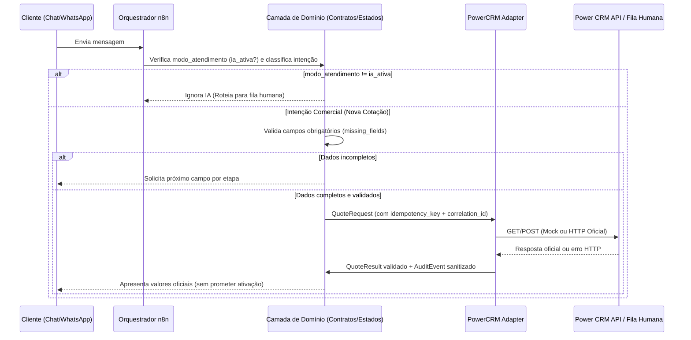

# Arquitetura Técnica de Referência | BGR Agente Comercial IA
**Versão**: `1.0.0`  
**Data-base**: `2026-11-10`

---

## 1. Visão em Camadas

1. **Camada de Canais (`src/channels/`)**:
   - Ciclo 1: `Chat de Teste` nativo do n8n para homologação.
   - Ciclo 2 (Fase 5): API Oficial do WhatsApp Business (Cloud API v18.0) com separação entre `ACK HTTP 200` do Webhook e envio assíncrono via `POST /messages`.
2. **Camada de Orquestração (`workflows/` + `n8n/exports-sanitizados/`)**:
   - Mantém o **n8n** como orquestrador do fluxo de conversação e agendamento de rotinas, acionando módulos validados e preservando isolamento de sessão (`session_id`).
3. **Camada de Inteligência (`prompts/` + `knowledge-base/`)**:
   - LLM (`gpt-4o-mini`, temperatura `0.4`) guiado por instruções versionadas (`prompts/system.md` e `prompts/developer.md`) e Base de Conhecimento auditada da BGR.
4. **Camada de Domínio (`src/domain/` + `src/services/`)**:
   - Validação de contratos tipados (`Lead`, `Vehicle`, `QuoteRequest`, `QuoteResult`, `Conversation`, `Consent`, `Opportunity`, `Handoff`, `PaymentStatus`, `AuditEvent`).
   - Máquina de estados comercial que impede ativação prematura ou invenção de preços.
5. **Camada de Integração (`src/integrations/powercrm/`)**:
   - `PowerCRM Adapter` com suporte a `MockProvider` (para desenvolvimento e testes independentes) e `HttpProvider` (com timeout, retry controlado apenas em `GET`, idempotência e correlação de erros).
6. **Camada de Observabilidade e Segurança (`src/observability/`)**:
   - Mascaramento automático de dados pessoais (CPF, placa, telefone, cartão) e bloqueio de vazamento de tokens (`Bearer`, `sk-`, chaves de API) antes de qualquer persistência em log ou banco de auditoria.

---

## 2. Diagrama de Fluxo e Contratos

